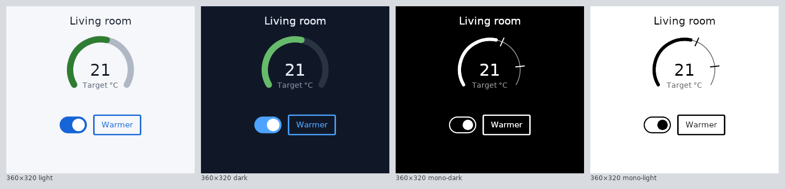

# Kobento: a catalog of its components, and export to Kobento JSON or a plain `.rc`

**Status: first slice landed, 2026-11-18.** The catalog is generated data and an exporter exists,
both proven by `KobentoCatalogTest`. No host serves the catalog yet, and no export format is
advertised for it. This document is the landing plan for the rest.

[Kobento](https://mcp.kobento.dev/) (github.com/kobento, Apache-2.0, pre-1.0, not Google) is an
independent Remote Compose implementation: a C++ engine, a TypeScript player, iOS, desktop,
microcontroller players (ESP32, STM32, Raspberry Pi) and `json2rc`, a TypeScript compiler of
AndroidX **authoring JSON** to `.rc`. On top of the format it has a **component library**: 96
components (buttons, charts, clocks, maps, 3D, layouts), each drawn in four looks (light, dark,
mono-dark for always-on OLED, mono-light for e-ink). A document calls them like this:

```json
{"Button": {"label": "Sign in", "fill": true, "onClick": {"type": "hostNamedAction", "name": "signIn"}}}
```

and picks libraries with `"componentSets": ["lib:<name>", ...]`. The library is **server-side**.
Its source is in the private `kobento-mcp`, and the public `json2rc` does not expand calls. Only
Kobento's MCP `convert` turns a call into plain format JSON.

## What landed

| Piece | Where | What it proves |
| --- | --- | --- |
| Published catalog | `docs/design/fixtures/ui-builder/kobento-published-v1.json` | a `ui-builder.json` that `PublishedUiBuilderCatalog` composes with **no record**: every component is a builtin, with its params (type, required, enum values) and slots |
| Exporter | `ui-builder-export/.../KobentoComponentJsonExporter.kt` | a design over that catalog lowers to Kobento component JSON |
| Test | `ui-builder-runtime/.../KobentoCatalogTest.kt` | all 96 are served under their ids, a sample design **validates in the runtime** against the served catalog, and it exports to the golden `kobento-export-sample.json` |

The published catalog is a **capture** from [`yschimke/kobento-catalog`](https://github.com/yschimke/kobento-catalog),
which owns the generator (`generator/snapshot.py`), the interface snapshot it is generated from
(`catalog/components.snapshot.json`) and the published catalog (§5). Only the published file is
kept here, because it is all the test reads. Re-capture it as a reviewed change when that catalog republishes, the same way
`remote-m3-published-v1.json` is re-captured from its delivery branch. The generator's `fetch`
needs a Kobento token and is the only step that touches the network. Its `check` regenerates the
published file from the snapshot offline and fails if they disagree, and that check runs in the
catalog's own repository, not here.

## 1. Getting the component list into a catalog

**Done: a snapshot generator.** Kobento's MCP `find {"kind": "components", "interface": true}`
answers every component with its params and slots, as JSON. That is a machine-readable manifest
in all but name, so a generator does not need to scrape anything. The script keeps **interface
facts only**: names, param types, defaults, enum values, `static`, required, and slot names and
optionality. It drops Kobento's summaries, docs and pitfalls. Those are Kobento's prose, served
from a private repository, and committing them would be a copy of content whose licence the
public repos do not state.

Why every component is a builtin: the catalog contract's record (`components.json`) describes
Kotlin call sites (symbol, `typeFqn`, imports). A Kobento component has none. A builtin is the
contract's word for "exists because the policy says so", and the published reader already serves
a catalog that is builtins only (`record: null`). So no contract change was needed.

The type mapping (Kobento -> `jsonType`): `float` -> number, `bool` -> boolean,
`string`/`text`/`color`/`enum`/`variable` -> string (enum with `allowedValues`), `list` -> array.
`action` params are **not** properties. A design states a tap as a `click` event binding, and the
exporter writes it as `onClick`. Which components take one is listed in
`statusSemantics.kobento.clickable`.

Ids are `kobento/<kebab>` (`ActivityRings` -> `kobento/activity-rings`, `Chart3D` ->
`kobento/chart3-d`). The generator refuses a name that does not round-trip, and the test checks
all 96. Two builtins are the format's own rather than the library's: `kobento/document` (the
screen root: a `fillMaxSize` column on `@colors.background`) and `kobento/text` (the format's
`text`). `layout/column|row|box` come from the builder's own vocabulary, as for every catalog.

**Recommended next: ask Kobento upstream for a published manifest.** The snapshot works, but it
is a copy that goes stale silently, exactly like `.github/scripts/decoder-shapes.json`
(AGENTS.md, "Assets whose writer is in the other repository"). The better end state is Kobento
publishing the same `find` answer as a versioned file (`/libraries/default/manifest.json`, or a
release asset). The generator then reads that URL with no token. The ask is small, because the
data already exists and is already JSON. Until then, `fetch` is run by hand with a token.

Gaps in the snapshot that a manifest would close:

- **Menu groups.** The site says 33 basic, 46 advanced and 17 layout components, but the
  interface answer carries no group. The shelf has one `Components` group for now.
- **Param docs.** A property's `notes` say only its Kobento type, its default and whether it is
  `static`.
- **Two-way params.** `variable` params (`Switch.checked`, `Slider.value`) are written by the
  component itself: a tap flips the bound variable. The builder treats them as plain inputs, so
  an author can bind state but the canvas does not know the component writes back.

## 2. How the canvas draws Kobento components

Kobento components are not compiled Compose, so the Wasm canvas cannot compose them. The options,
in order:

1. **Placeholders (landed).** Every builtin declares `canvas: "placeholder"`, and
   `previewSurfaces.wasm.fidelity` is `approximate` with the reason stated. The layout is real.
   Each component is a labelled box.
2. **Play the converted `.rc` (recommended next).** The Remote preview lane exists
   (`RemoteDocumentPreviewPane`, `browserPreview.renderer: remote-compose-document`), and Kobento's
   TypeScript player is already vendored in compose-ai-tools as the `camaelon-js` RC player
   (`render-host/.../RcPlayerBackend.kt`). The preview pane would export the design, `convert` it
   through Kobento (a host-side call, with the token on the host), and play the bytes. That gives
   the true picture, including the four looks, and keeps the token out of the editor.
3. **Stand-ins.** Drawing Kobento's components natively in the canvas is a second implementation
   of a library this repository does not own. Not recommended.

Until (2) lands, the authoritative picture is Kobento's own `render` or `convert {check: true}`.
The sample below was rendered that way.

## 3. Export

### (a) Kobento component JSON (landed as an API)

`KobentoComponentJsonExporter.export(document, Options(componentSets, componentTheme))` writes:

- `header` at the design's **dp** size, `apiLevel` 7, `profiles` 513. Kobento documents are
  authored at density 1.
- `componentSets` and `componentTheme` when given. A theme is one of `auto`, `all`, `light`,
  `dark`, `mono-dark` or `mono-light`.
- `resources.variables`: every bool, int and float state variable as an exported float, with a
  bool as an exact 0/1, which is what Kobento's components take.
- the tree in Kobento's keyed form (`{"column": {...}}`). A component property is its literal or
  `"@variable"`. Slots go under `"slots"`. A `click` binding becomes `onClick`: `set` ->
  `valueFloatChange`, `toggle`/`increment` -> `valueFloatExpressionChange`, and a host action ->
  `hostNamedAction`.

Anything it cannot say is **refused with a path**, never dropped. That covers string state,
component arguments, unknown modifiers and component modifiers (a call takes params).

Only Kobento's `convert` compiles this document. It is the format to hand a Kobento user, a
Kobento MCP session or `kobento-net`'s `POST /send` path after conversion.

### (b) A plain `.rc`, playable anywhere

A component call cannot be expanded locally, so every plain form of a Kobento design starts at
Kobento's `convert`. There were two candidate routes. The experiments settle which to use.

1. **`convert`'s own `.rc` bytes (recommended).** The sample's `.rc` (2917 bytes) **decodes
   completely in AndroidX `remote-core` 1.0.0-alpha23** (`RemoteComposeJson.dump`). Its operations
   are all standard: `LoopOperation`, `ColorExpression`, `FloatExpression`, `NamedVariable`,
   modifiers and paint. The only entries the dump cannot print are the header and the theme
   markers, which AndroidX-compiled documents show too. So the bytes Kobento writes are the
   portable artifact.
2. **`convert {"expanded": true}` -> `remotecompose-json` (unextended) -> `.rc`: not reliable.**
   This route treats the expanded JSON as AndroidX authoring JSON. For the sample, AndroidX's
   parser **refuses it twice**:
   - `Variable not found: target`. The Gauge's expansion declares
     `gauge1_frac: "(@target - 10) / (30 - 10)"` in `resources.variables`, after `target`. The
     AndroidX parser on the JVM walks that object in `org.json`'s `HashMap` order, where
     `gauge1_frac` (bucket 0) comes before `target` (bucket 15). `json2rc` resolves it in source
     order. Renaming the variables so that hash order equals source order clears this error,
     which confirms the cause.
   - Then `JSONObject["operation"] is not a string`. The Switch's expansion writes
     `textTransform` with `"operation": 3`. `json2rc` accepts the number, and AndroidX wants the
     operation's name.

   Kobento's audit reported "no errors or warnings" for the same document. Its Android check
   covers expressions the Android **player** rejects, not what the Android **JSON parser**
   accepts. That is a fair line for Kobento to draw, because its product is the bytes. It is
   worth telling them, since "byte-identical to the Java parser" invites people to use the
   expanded JSON as a portable source.

**Evidence of dialect parity on plain documents.** Kobento's plain dialect and AndroidX's are the
same language, apart from the two divergences above. Eight catalog examples (LAY-01, -02, -09,
-10, -11, -12, -17, CMP-05) were fetched as expanded JSON. They were compiled with
`remotecompose-json` 2.100.0 (for an unprofiled document, `RemoteComposeJsonParser` alpha23) and
with Kobento's `convert` (`json2rc`):

| Example | bytes (AndroidX) | bytes (Kobento) | result |
| --- | ---: | ---: | --- |
| LAY-01 column stack | 407 | 407 | identical |
| LAY-02 row arrangements | 2659 | 2659 | identical |
| LAY-09 responsive fitBox | 992 | 992 | identical |
| LAY-11 horizontal carousel | 1395 | 1395 | identical |
| LAY-12 gone vs invisible | 1376 | 1376 | same operations, 2 named integers in a different order |
| LAY-17 baseline units (Card) | 2671 | 2671 | same operations, themed colours in a different order |
| LAY-10 scrolling list (ListItem, Avatar) | 6109 | 6109 | same operations, themed colours in a different order |
| CMP-05 list screen (5 components) | 5338 | 5338 | same operations, themed colours in a different order |

All eight compile under AndroidX. Four are byte-identical. The other four are the same length,
and a dump of both shows the **same operation stream**: only the ids given to **named
resources** (`resources.integers`, `resources.colors`) are permuted. The cause is the same
`HashMap` walk. None of these documents has a derived variable, so none hit the forward-reference
refusal.

One parser-ordering experiment did not settle anything: swapping in Android's own `org.json`
(`android-json`) failed earlier, inside the parser's error path (`NoSuchMethodError` on a
`JSONException` constructor). It says nothing about how the parser behaves on a device, where
`org.json` keeps insertion order.

The local `json2rc` build was not executed, because it is code from an unvetted clone. Kobento's
hosted `convert` stood in for it, since `convert` is `json2rc` plus expansion. The harness was a
scratch Gradle project depending on `ee.schimke.composeai:remotecompose-json:2.100.0`, with a
`main` that calls `RemoteComposeJson.compile` / `dump`. It is not committed: it would be a second
Android-dependent build, and the committed form of this check belongs in `kobento-catalog`
(§5).

**Consequence for the profiles caveat.** `RemoteDocumentJsonExporter`'s extension profiles
(`compose-preview-integer-expressions-v1`, `compose-preview-state-v1`) are not accepted by AndroidX
or `json2rc`. They do not matter on route 1, because Kobento writes the bytes. They would matter
only for a `layout/*`-only design exported through `RemoteDocumentJsonExporter` and then handed
to Kobento. That exporter adds a profile as soon as state selection or a string state appears.

### The sample, rendered by Kobento

`kobento-export-sample.json` is the test's golden: a thermostat card with a `Gauge` bound to
`@target`, a `Switch` bound to `@heating`, and an outlined `Button` that increments `target` and
sends `thermostat.target`.

`convert {"check": true, "looks": [...]}` on that file, unedited, renders it in Kobento's C++
engine in all four looks. It reports no findings at any look, an audit with no errors, and a
screen reader reading "Living room"; "Target °C"; "Heating, On"; "Warmer":



The mono looks are not recoloured light/dark. The gauge drops its zone colours for tick marks,
and the switch becomes an outline. That is why a look is an export option, not a builder theme
(§4).

## 4. Device presets, frames and looks

Presets are the host's (`UiBuilderDevicePreset`), so the catalog states none. These are the boards
Kobento ships firmware for (`kobento-mcu/esp32/README.md`):

| Board | Panel | Frame | Look |
| --- | --- | --- | --- |
| M5Stack Tab5 | 720x1280 portrait | rect | light/dark |
| M5Stack PaperS3 | 540x960 e-ink, density 1.5 (360x640 dp) | rect | mono-light |
| Waveshare ESP32-S3-Touch-AMOLED-1.8 | 368x448 AMOLED | rect (rounded corners) | dark or mono-dark |
| Waveshare ESP32-S3 1.28" round | 240x240 GC9A01A | round | dark |
| Elecrow CrowPanel 1.28" rotary | 240x240 round, knob | round | dark |
| M5Stack Core2 | 320x240 | rect | light/dark |
| LCDWIKI ES3C28P 2.8" | 320x240 | rect | light/dark |

The prompt's "466 round" is a Wear-class AMOLED (as in some ESP32-S3 watch boards). It is not in
Kobento's current board list, but it fits the existing `frame/round-screen` adapter with no change.

**Looks are not themes in the builder's sense.** Kobento expands a call differently per look: mono
is a separate implementation with no animation, not a palette. So a look is an **export option**
(`componentTheme`), and the preview's look picker should re-convert, not recolour. The catalog
lists the four in `statusSemantics.kobento.looks`. A host pairs each preset with a default look
(PaperS3 -> `mono-light`), and the author can override it.

## 5. Where it lives

**Decided: a separate repository, [`yschimke/kobento-catalog`](https://github.com/yschimke/kobento-catalog),
publishing to `yschimke/kobento-catalog-out` on `design-artifacts/kobento`**, the way `m3-catalog`,
`wear-m3-catalog` and `remote-m3-catalog` publish their catalogs. `PublishedCatalogLocation.DEFAULTS`
then gains one row, and the offline hosts open it like any other. That is the
catalog-agnosticism contract working as designed: the builder carries no Kobento definitions.

Why not here: the catalog's source of truth is another party's server. Its refresh cadence (a
token, a manual or scheduled `fetch`) and any Kobento-specific tooling (render checks, publishing
back as a library) have nothing to do with this repository's release train. Kept here, it would be
the same "snapshot with no generator in this repo" problem AGENTS.md already names twice.

What stays **here** is what every catalog relies on: the exporter (a lowering, like
`RemoteDocumentJsonExporter`), the test fixture that pins the exporter's input, and this plan. The
fixture in `docs/design/fixtures/ui-builder/` is the same kind of capture as `remote-m3-published-v1.json`.

It was set up in [kobento-catalog#1](https://github.com/yschimke/kobento-catalog/pull/1). The layout
it started from:

```
kobento-catalog/
  README.md                     what it is, the token, how to refresh
  generator/
    snapshot.py                 the generator, first written here and moved there
  catalog/
    components.snapshot.json    the interface snapshot (or the upstream manifest URL, once it exists)
    ui-builder.json             the generated, published catalog
    ui-builder.policy.json      hand-written: groups, display names, which looks, board presets
  designs/                      seed templates (a thermostat card, a round clock, an e-ink dashboard)
  .github/workflows/
    publish.yml                 generate ui-builder.json from snapshot + policy, push design-artifacts/kobento
    refresh.yml                 weekly `fetch` with a KOBENTO_TOKEN secret, open a PR on drift
    render-check.yml            convert each template through Kobento in all four looks, attach PNGs
```

`ui-builder.policy.json` is where the hand-curation goes (groups, the `variable` params' two-way
nature, preset/look pairs). The generator merges it over the snapshot, as the other catalogs'
generators do.

## 6. Optional directions

- **Kotlin source export: no.** Kobento has no Kotlin authoring path, so there is nothing to
  generate against. A Kobento design exports as JSON or `.rc`. The `.rc` is what an Android host
  plays (`RemoteDocumentPlayer`), and that covers "use this in my app".
- **Publishing a UI Builder catalog back as a Kobento library** (`libraries publish`). A library
  component is a JSON definition with params, slots and a body in the format. The builder's
  `components` (reusable design components, `UI_BUILDER_REPETITION_AND_COMPONENTS.md`) have the
  same shape. A builder component over `layout/*` + `kobento/*` could be lowered by this exporter
  into a definition body, with its arguments as params. That is a real feature, not a slice. The
  exporter refuses `binding` values today precisely because component arguments are not lowered
  yet.

## Landing order

1. ~~Snapshot generator, published fixture, exporter, runtime test~~ (this slice; the generator
   has since moved to `kobento-catalog`).
2. ~~Stand up `kobento-catalog`~~ (kobento-catalog#1), publishing to
   `kobento-catalog-out` on `design-artifacts/kobento`. ~~Add the `PublishedCatalogLocation` row
   and the desktop's `OfflineCatalog.KOBENTO`~~, so the offline hosts open it like any other
   catalog. Its host-test capture is `catalog-cutover/kobento/`, taken with
   `scripts/capture-catalog-cutover-fixtures.sh kobento`. ~~Seed templates~~ (kobento-catalog#2):
   a new design opens `kobento-screen` (a `kobento/document` holding a column and a text), and
   `kobento-thermostat` is listed under New from template. Still open: ask Kobento for a published
   manifest.
3. Advertise the export. This needs a contracts change: `ExportFormatV1` has `JSON` and `RC` but
   no "component JSON". Add `KOBENTO_JSON` (or a generic `REMOTE_COMPONENT_JSON` with the
   component-set list as an option), gated per catalog as `remoteJson`/`remoteDocument` are. Then
   wire it into the server's `ui_builder_export` / `export_design`. The plain `.rc` is a host
   step: `convert` with the host's token, keeping Kobento's bytes (§3b, route 1). It is not a
   local recompile.
4. The preview pane plays the converted `.rc` through the Kobento TS player, with a look picker.
5. Board presets in the hosts, each with its default look.

## Open questions

- **Licence of the component metadata.** The snapshot keeps interface facts only. Kobento should
  say whether a published manifest may carry docs too.
- **Who holds the token.** `convert` needs a Kobento account. A preview server converting on the
  author's behalf needs either the author's token or a service account. That is a product
  decision for the host, not this repository.
- **Ordering parity.** Is the AndroidX parser's resource-id order worth an upstream issue, so the
  two compilers agree byte-for-byte? It changes no behaviour, but byte equality is the cheap gate.
- **3D.** `Scene3D` and `Chart3D` are in the catalog, but Kobento says 3D does not play on
  AndroidX's player yet. Should the catalog mark them, so a design aimed at Android is warned?
