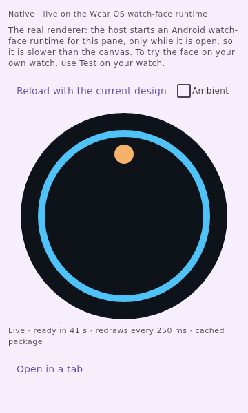
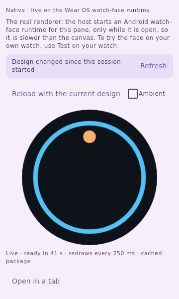

# Watch-face Native pane: "Design changed · Refresh"

The pane starts one watch-face runtime session when it opens and another only on an explicit
Refresh or Reload. An edit never restarts, repackages or reinstalls the face; once the design has
moved past the session's revision the pane says so and waits.

| Before: a live session, edited or not | After: the design moved past the session |
| --- | --- |
|  |  |

Rendered from `WatchFaceNativePaneLivePreview` and `WatchFaceNativePaneStalePreview`.
