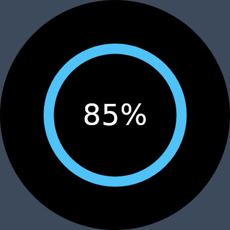
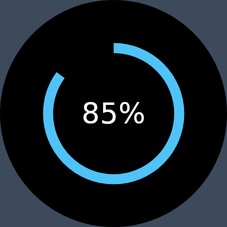
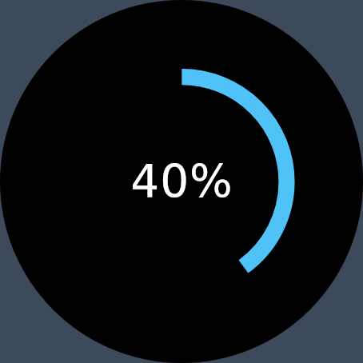
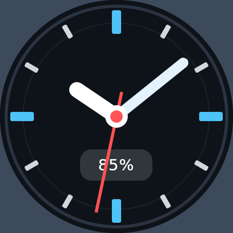
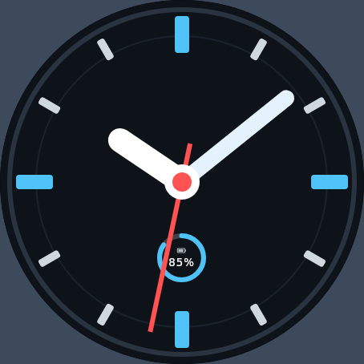
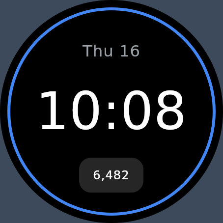

# Watch face: complication sample data

| | Before | After |
| --- | --- | --- |
| RANGED_VALUE arc face (battery, 85 of 100) |  |  |
| Same face, value picked to 40 | — |  |
| Analog template (SHORT_TEXT) |  |  |
| Analog template, RANGED_VALUE picked (no content for it: tidy default) | — |  |
| Digital template (SHORT_TEXT) |  |  |

Before, an `<Arc>` drew a full ring whatever its angles, and `[COMPLICATION.RANGED_VALUE_*]` had no
value. After, the arc's `endAngle` expression is evaluated against the provider's sample and the arc
is drawn from its start to its end angle. The templates' text slots are unchanged.

Regenerate: `./gradlew :ui-builder:jvmTest --rerun --tests '*WffComplicationSampleTest*'` and copy
from `ui-builder/build/watchface-renders/`.
