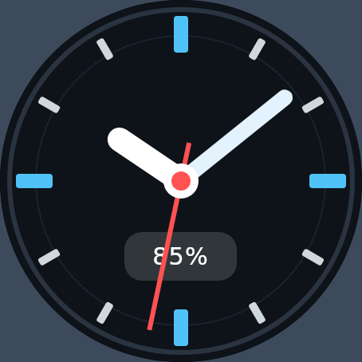
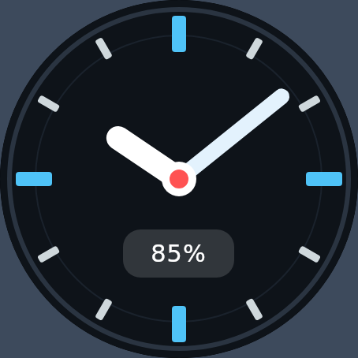
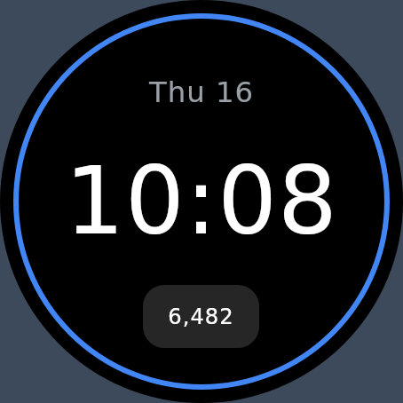
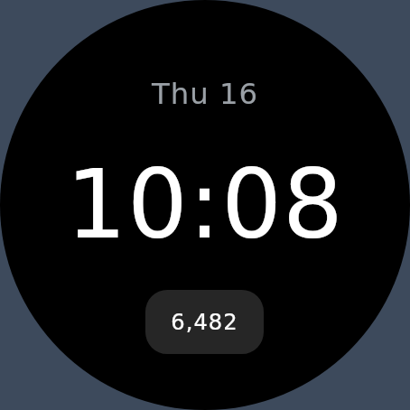

# Watch face: real clock, Interactive and Ambient

The `wff-watchface` templates drawn by `WatchFaceCanvas`, 227dp at 2px to the dp.

| Before | After: Interactive | After: Ambient |
| --- | --- | --- |
|  |  |  |
|  |  |  |

Before, a face was drawn only interactive, frozen at the template's `fixedTime`. After, it follows
the real clock (these captures fix the time at 10:08:32 so they are repeatable) and the Preview pane
shows each frame twice: Interactive, and Ambient, which applies the design's
`<Variant mode="AMBIENT">` overrides, leaves out what they make transparent (the analog second hand,
the digital ring) and draws on black.

Regenerate from the repository root (the before pictures come from `WatchFaceRenderTest` on the
parent commit):

```sh
./gradlew :ui-builder:jvmTest --rerun --tests '*WffAmbientTest*'
# then copy ui-builder/build/watchface-renders/{analog,digital}-{interactive,ambient}.png here
```
