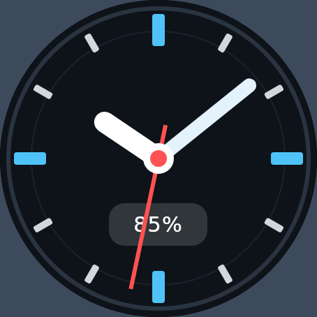

# Watch face: typed transforms

| Before (raw `<Transform>` XML) | After (`wff/transform`, Rotate with presets) | Hour preset at 03:00 |
| --- | --- | --- |
|  |  |  |

The analog template's three hands moved from `wff/raw` `<Transform>` XML to `wff/transform` nodes
with `rotateWith` hour, minute and second-sweep. The two renders at 10:08:32 are pixel-identical:
the canvas now evaluates the typed node (the exporter's own `transformOf`), and reads a raw
`<Transform>` in an older design as the node an import makes of it. The third is
`WffTransformCanvasTest`'s bar driven by the hour preset at 03:00.

Regenerate: `./gradlew :ui-builder:jvmTest --rerun --tests '*WffAmbientTest*' --tests '*WffTransformCanvasTest*'`
and copy `ui-builder/build/watchface-renders/{analog-interactive,transform-hour-0300}.png` here.
